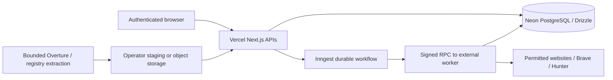

# Architecture

Next.js 16 App Router, React, TypeScript and Tailwind 4 provide the application on Vercel. Radix Dialog and shadcn-style component primitives provide the evidence drawer. The interface preserves the supplied blue/navy PNGs, with shared light/dark surface tokens, persisted Light/Dark/System preferences and accessible mobile navigation drawers; transitions respect reduced-motion. No external font request is required. No AI model is used to manufacture records, scores or evidence.

## Boundaries

Vercel does ordinary auth, search creation, data management and export. Crawling, website checks, public email extraction, DNS/MX and vendor verification run only on the separate Node worker. Google and known Meta profile access tests run in ordinary APIs; their bodies are never persisted as lead data. No bulk scrape runs in a Vercel Function.

## Data

The initial Drizzle migration creates users, sessions, accounts, auth verification/rate-limit records, search_jobs, job_items, job_events, businesses, verification_evidence, source_configs, source_usage, quota_counters, ingestion_batches, saved_leads, suppression_list, audit_events, geo_places and exports. These tables include owner/location/source/idempotency indexes and cascading user-data deletion. Five-dimensional evidence, field rights and per-contact provider details are typed JSONB inside business snapshots; verification history is append-only until retention cleanup. This is a compact initial model, not every table listed in the aspirational specification.

Businesses deduplicate by normalized name + country + region + city and unique source/source_id. A shared domain never merges franchise branches. This conservative scheme does not yet perform fuzzy entity resolution or cross-location rebrands. Duplicate source evidence/contact origins are retained on merge, without borrowing export rights from another email. Imported verifier claims are discarded.

Domains/portfolios are persisted as job input and matches in job-item snapshots, not standalone portfolio CRUD tables. Matching is deterministic ordinal association ranking (3/2/1), not calibrated probability or buying intent. Common personal names remain ambiguous and excluded from qualified exports. Domain searches currently use the bounded imported candidate pool for the selected city; automatic global company discovery is not implemented.

## Workflow and recovery

1. Better Auth session and mutation Origin checks establish ownership. Zod validates location, product, niche, source, date range, domain ownership and budgets.
2. A transaction creates the job and atomically reserves owner daily work units. Owner + idempotency key is unique. Requests exceeding configured limits roll back. No billing/qualified-lead-credit system exists.
3. The API sends a stable Inngest event. A failed send leaves `DISPATCH_FAILED` with a visible retry action; no job is silently lost. There is no automatic outbox recovery scheduler yet.
4. Inngest calls the worker for discovery and persists its steps. The worker selects only owner-authorized imported data and stores candidate items. Exact geography/niche filters run before qualification; domains then use strict targeted matching.
5. For each candidate Inngest makes short signed requests to start/check work. The worker persists a five-minute exclusive item lease with a unique fencing token and runs enrichment outside the request lifecycle. Inngest sleeps durably between polls; another worker can reclaim expired work after a crash. Completed items are idempotent. Provider failures remain uncertain outcomes. Polling is bounded; exhausted polling marks a job failed for explicit resume.
6. A transaction saves the result, evidence history, processed/qualified counts and completed item. Cancel is checked before processing and committing. Completed counts describe that run; export recomputes current eligibility and suppression.
7. Retry resumes a failed/cancelled job and skips completed items. It is **not a revalidation** of already completed items; launch a new search to recheck contacts.

Owner quotas reserve worst-case candidate/provider work units, rather than dollar charges. Shared provider daily counters and per-job request counters are atomic. Each provider attempt uses quota, including failures. Unused reserved units are not refunded. Current UI shows reserved units and quality breakdowns; provider invoice dollars, calibrated accuracy, real-world bounce rates and cost-per-qualified monetary metrics are not fabricated and remain future work.

## Qualification

- Trading activity: at least two fresh evidence origins, one independent, no closure contradiction. Dataset existence/open, legal registration, page loading and copyright do not suffice. Stale or conflicting signals need review.
- Website: approved host, permitted robots response, pinned-public DNS, bounded HTML, title/heading identity, substantial content, navigation and no parked/default/anti-bot indicators. TLS/timeout/blocked results remain uncertain. This heuristic is conservative, not full browser-rendered malware detection or contact-form testing.
- Website absence: no owned website, two independent documented absence checks, recent timestamp. Importing a blank website column is insufficient. User reviews are clearly attributed as user evidence; the product does not independently certify their truth.
- Email: sourced business contact; exact binding; permitted per-contact rights; syntax and MX; Hunter assessment. Catch-all, webmail uncertainty, unknown, disposable, invalid, blocked and unverified never qualify. Preserve actual vendor verification dates. Missing verification dates cannot establish freshness.
- Freshness: email/site 30 days, activity/contact source 90 days. Policy ages are validated environment settings with 30/30/90 day defaults. Exports exclude stale evidence; automatic export-time refresh is not yet implemented.
- Suppression and fixture flags always override eligibility. Mailbox opt-out, bounce and wrong-email feedback also block that address across other business records owned by the account. Employee-currentness is never asserted.

## Security

Better Auth hashes passwords and stores random HttpOnly session tokens. Cookies are secure in production. Database auth rate limits are shared across instances. No development-auth bypass exists. All business/job APIs enforce owner predicates. Source imports and host-rights changes require explicit ADMIN_USER_IDS membership. Mutations require the configured web origin. API errors hide database URLs and upstream keys. UI never renders fetched HTML.

Worker calls use HMAC-SHA256 over timestamp and exact body, constant-time comparison, 60-second replay window, body size limit, HTTPS in production and idempotent database claims. The worker is a separate trust boundary: restrict its ingress where hosting allows, rotate secrets, and do not expose database credentials to browsers. Replay within the small validity window is harmless for completed/leased work, but this is not a persisted nonce ledger.

Crawl requests reject private/reserved/mapped IPs, credentials, dangerous schemes, nonstandard ports and mixed public/private DNS answers. A validated DNS address is pinned into the actual TCP/TLS connection. Redirects are revalidated and limited to approved hosts; bodies, time, pages and crawl delays are bounded; compressed responses are refused. No authentication/CAPTCHA bypass, proxy rotation, script execution or intrusive SMTP probes occur. Site terms require explicit operator review in addition to robots. HTML email findings on different domains stay uncertain unless a directly published consumer mailbox is clearly associated.

Production still needs operator-specific legal/privacy text, live transactional-email delivery verification, monitoring, authenticated live staging tests, network-level egress restrictions and load testing. Do not launch paid access solely because unit tests pass.

## API contract

All application responses set `Cache-Control: no-store`. JSON errors carry a safe `error` string. Authentication routes are Better Auth under `/api/auth/*`; Inngest verifies signed workflow calls under `/api/inngest`.

| Route                                                    | Method     | Purpose                                                               |
| -------------------------------------------------------- | ---------- | --------------------------------------------------------------------- |
| `/api/status`                                            | GET        | Safe configuration booleans + source capability descriptions          |
| `/api/session`                                           | GET        | Current account / admin status                                        |
| `/api/dashboard`, `/api/cities`                          | GET        | Owner metrics/coverage and licensed geography suggestions             |
| `/api/jobs`                                              | GET / POST | Paged history / create job with `Idempotency-Key`                     |
| `/api/jobs/:id`                                          | GET        | Paged results, progress, evidence, quality breakdown                  |
| `/api/jobs/:id/cancel`, `/retry`, `/export`              | POST       | Cancel, resume or recomputed qualified two-column CSV                 |
| `/api/leads`, `/api/exports`                             | GET        | Paged saved leads / export audit history                              |
| `/api/leads/:id/save`, `/remove`, `/suppress`, `/review` | POST       | Owner lead management, flags and attested evidence                    |
| `/api/sources`                                           | GET        | Capabilities, owner host policies and reserved usage                  |
| `/api/sources/website`, `/api/imports`                   | POST       | Admin rights configuration / bounded CSV or JSONL ingestion           |
| `/api/sources/test`                                      | POST       | Admin, budgeted restricted-API connectivity test; no lead persistence |
| `/api/account/delete`                                    | POST       | Cascading removal after exact typed confirmation                      |

## Customer and administrator boundaries (experience revision)

The four search product IDs and existing routes are retained; customer labels are Businesses With Websites, Businesses Without Websites, Domain Buyer Finder and New Business Finder. Lead Management & Export is the fifth feature, backed by existing saved-lead and export workflows. `/tour` is a synthetic UI-only walkthrough with no record creation or export path.

`/admin/sources` checks the server session and `ADMIN_USER_IDS` before rendering. The old `/settings/sources` redirects to it. Source reads, writes, imports, tests and `/api/admin/status` enforce administrator authorization independently. Public `/api/status` provides only auth/registration/recovery/search availability booleans; configured does not establish live provider health. Private record/history/account pages redirect anonymous sessions to sign in, and APIs retain owner checks.

Admin import/host approval forms can target an existing customer email. The server resolves it only after admin authorization, persists records and policies under that account and audits the provisioning actor/target. There is no automatic shared dataset or cross-tenant read. Customers never upload source datasets or manage provider keys.

Auth retains Better Auth’s hashing, database sessions, origin/CSRF validation and shared rate limits. Recovery uses the existing verification table, a 15-minute random single-use token, atomic consumption, session revocation and Resend transactional mail. Email links are restricted to the configured origin; the recovery UI makes no delivery/registered-account claim. Reset pages have no-referrer/no-store responses. Production registration requires configured mail and email verification. Mail exceptions are logged without recipient, body or token and do not change recovery responses, preventing account enumeration through provider failures. Live sender verification, inbox delivery and Neon staging remain required operational checks.

Transactional auth tasks use Better Auth’s background-task hook with Next.js `after`, so Vercel keeps delivery work alive without waiting for provider latency before returning the recovery response. Production inbox delivery still needs live validation.
