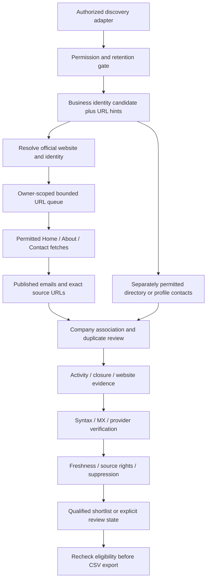

# Lead discovery next phase

Research date: **2026-11-05**. Status: **proposal for implementation after frontend approval**. No paid discovery provider was activated, no prospect search/crawl campaign was launched, and no competitor's private algorithm was accessed. Public documentation and marketing claims are distinguished from tested behavior below. Prices and contracts must be rechecked before spending.

## Existing implementation and the next boundary

LeadAtlas already has owner-scoped imports, a separate worker, DNS-pinned safe fetch, explicit website host permissions, robots checks, bounded public-page extraction, Hunter verification, evidence freshness, suppression, deterministic domain matching, CSV gates and Inngest orchestration. Global domain discovery adapters and an optional disabled AI explanation adapter were added in the preceding branch. Their existence does not establish operational credentials, permissions, international coverage or live accuracy. See [current architecture](ARCHITECTURE.md) and [product correction limitations](PRODUCT_CORRECTIONS.md).

The next implementation should make URL-first enrichment a reusable pipeline for all appropriate products. Retain the local search and global domain contracts separately. A URL is a research candidate, not a verified company; an email found on that URL is not automatically a qualified contact. The newsletter subscriber database is a separate opt-in audience and must never become a prospect source.

## Proposed discovery-to-verification workflow



1. **Discover** through an approved provider with a request budget, market/language context, cursor and source policy. Keep provider IDs and attribution only where permitted. Restricted search/Maps fields remain transient or display-only; do not launder them into a reusable lead by copying them between adapters.
2. **Resolve identity and website.** Normalize HTTP(S) URLs and registered domains with public-suffix awareness. Validate redirects, canonical host and plausible company name, address, location or independently sourced registration identity. Global domain buyers do not need to mention an invented US city. Shared hosting, agencies, franchise branches, resellers and similar personal names require explicit disambiguation.
3. **Queue approved URLs.** An owner-scoped task key includes business ID, canonical URL, policy version and research freshness window. Durable claims have fencing tokens; cancellation and revoked permissions are checked before fetching and committing. Different tenants cannot retrieve each other's research or rights.
4. **Fetch a small public surface.** Initially Home plus at most two same-site About/Contact pages, one site at a time per host. Use the existing safe fetch protections for DNS rebinding, mixed public/private answers, IPv6, credentials, redirects and byte/time limits. Check robots and crawl delay; stop on authorization requirements, CAPTCHA, 401/403/429 or policy uncertainty. Do not add stealth browsers or account automation. A JavaScript-only site stays unassessed until a separately reviewed rendering strategy exists.
5. **Extract published contacts.** Preserve each exact page URL, observation time, method (for example `mailto` or visible page text), relevant identity evidence and field rights. Do not guess mailbox patterns, SMTP-probe arbitrary addresses or invent `info@` contacts. Avoid persisting complete page HTML unless an explicit retention policy permits it.
6. **Associate and deduplicate.** Prefer a company-domain mailbox on a page that independently matches the company. Consumer mailboxes require an explicit public business association. Exclude website-developer credits, directory operators, recruitment/privacy/abuse addresses unrelated to the intended contact task, template examples and contacts belonging to another company. Keep branch/entity conflicts for review; a shared domain alone must not merge franchise businesses. Normalize email casing safely without treating unrelated plus-addresses as identical people.
7. **Assess operation and closure.** Distinguish an accessible server from a functioning company website, and both from current trading activity. Keep dated first-party material and independent corroboration separate. A registration, copyright year, HTTP 200 or search snippet alone is insufficient. Preserve closure contradictions and temporary closure states.
8. **Verify deliverability.** Syntax and DNS/MX are prefilters. Retain provider-native states and checked dates; pending, unknown, catch-all, invalid, disposable and do-not-mail states must not become qualified. Associate results with the exact address checked. The [Hunter API](https://hunter.io/api-documentation/v2) separates domain email discovery from address verification and reports evidence/status fields; provider results still do not guarantee delivery, correct company association or consent to outreach.
9. **Qualify and export.** Reapply permission, source freshness, verified association, suppression/opt-out/bounce and owner checks at export time. Reverification must be budgeted; if refresh cannot run, exclude stale records or clearly return research for review. Preserve the existing two-column qualified CSV contract unless a separate version is approved.

**Businesses With Websites:** require the correct business name, an identity-matched functioning website and a correctly associated, sourced and recently verified public business email. Research without all three remains reviewable.

**Businesses Without Websites:** never manufacture a URL to make the crawler run. Use independently authorized directories or approved professional profiles for explicitly published business contacts, with their own rights and company association evidence. An empty website field is not proof of absence. Retain the existing independent absence evidence requirement; broken/parked sites are not automatically website-less opportunities.

## Source comparison and credentials

The following describes capability and evaluation priority, not permission to export any content returned.

| Source                                              | Listings / URL candidates                                                                     | Email contribution                                                                                        | Credentials and permission gate                                                             | Storage, export and attribution decision                                                                                                                                                                                                                                          |
| --------------------------------------------------- | --------------------------------------------------------------------------------------------- | --------------------------------------------------------------------------------------------------------- | ------------------------------------------------------------------------------------------- | --------------------------------------------------------------------------------------------------------------------------------------------------------------------------------------------------------------------------------------------------------------------------------- |
| Google Places API (New)                             | Place identities, website URI and business/status fields where the requested SKU exposes them | No general email field; requires a separately permitted source                                            | Google Cloud project, billing, restricted API key, approved purpose and field mask          | Keep the existing restricted/display-only boundary. Review the actual use case, regional terms and attribution before any expanded use. Place IDs have a documented caching exception; other content has restrictions.                                                            |
| Licensed Google/Bing SERP provider, e.g. DataForSEO | Search result URL hints, titles and available SERP features                                   | A snippet is not sourced business email evidence                                                          | Provider login/password or key, reviewed contract, engine/locale settings and bounded depth | A SERP licence does not license the underlying websites or automatically authorize contact resale. No raw response retention by default.                                                                                                                                          |
| Brave Search                                        | Independent web-index URL discovery                                                           | No independent deliverability or company-contact proof                                                    | Brave API key plus reviewed plan/use approval                                               | Use transient hints; enable only contract-permitted caching/retention. Independently verify the actual site. [Official search docs](https://api-dashboard.search.brave.com/documentation/services/web-search)                                                                     |
| Overture Maps Places                                | Bulk business/place identities, optional website lists, source metadata                       | Inspect the pinned release schema; no universal deliverable email field assumed                           | Public release access; operator-managed bounded extraction and per-record licence review    | Retain release/source attribution and permitted field provenance. [Official Places guide](https://docs.overturemaps.org/guides/places/) lists source-specific licences; source existence/confidence does not verify activity or emails.                                           |
| Authorized directories and public registries        | Company names, identifiers, locations and sometimes URLs                                      | Only explicitly published contacts included in a permitted dataset/API                                    | Dataset/API entitlement and explicit storage/export terms per source                        | Default deny if terms or contact ownership are unclear. A registry establishes legal identity, not necessarily current trading or a usable mailbox.                                                                                                                               |
| Facebook Pages                                      | Approved Pages API access may provide page/business context for permitted uses                | Only fields actually available under reviewed permissions; no assumption of an exportable email directory | Meta app/token, current Graph version, App Review/appropriate public-content permission     | Keep restricted by default. Public page visibility is not a bulk export licence. [Pages API documentation](https://developers.facebook.com/docs/pages-api/) was rate-limited during this audit, so current exact permission/field availability still needs operator verification. |
| Instagram professional Business Discovery           | Approved known-profile research, rather than universal city/niche discovery                   | No general email harvesting entitlement assumed                                                           | Appropriate professional-account/token relationship and approved permissions                | No login automation or scraping. [Official Business Discovery guidance](https://developers.facebook.com/docs/instagram-platform/instagram-api-with-facebook-login/business-discovery/) was rate-limited during this audit; confirm the current API contract before implementing.  |
| Independently permitted business websites           | Official business identity and live site evidence                                             | Published business emails with exact page origins                                                         | Reviewed host permissions, terms and robots policy                                          | Retain only authorized normalized evidence/contacts; record expiry and attribution as applicable. Robots permission alone does not settle reuse rights.                                                                                                                           |
| Hunter                                              | Known-domain sourced email discovery and separate verification                                | Found addresses plus sources; verifier assesses an exact mailbox                                          | API key; separate reuse approval for enrichment                                             | Preserve source dates, binding and native status; reuse entitlement and suppression remain mandatory.                                                                                                                                                                             |
| Common Crawl                                        | Historical URL/domain-index hints                                                             | Historical content is not fresh verification                                                              | Reviewed index/archive access and bounded query rules                                       | No inference of current activity or contact permission. Never bypass website restrictions using archived copies. [Index documentation](https://index.commoncrawl.org/)                                                                                                            |
| Apollo organization enrichment                      | Company enrichment by domain, URL or name                                                     | Organization enrichment is not proof of a published, correctly associated business mailbox                | Approved account/API scope and contract                                                     | Evaluate only after primary source rights. The [organization enrichment reference](https://docs.apollo.io/reference/organization-enrichment) documents a separate company endpoint and credit cost; personal-contact access is a different entitlement.                           |

Google's [field documentation](https://developers.google.com/maps/documentation/places/web-service/data-fields) and [Places policies](https://developers.google.com/maps/documentation/places/web-service/policies) support the listing/website versus email distinction and storage limits. Do not infer that independently visiting a Google-returned URL cures every contractual restriction: approve that discovery use first.

**Important current changes:** Microsoft states that the old [Bing Search APIs retired on 2025-08-11](https://learn.microsoft.com/en-us/lifecycle/announcements/bing-search-api-retirement). Do not plan a new integration against the old v7 endpoint or treat an LLM grounding service as a drop-in bulk-export API. A separately licensed provider can expose [Bing SERP results](https://docs.dataforseo.com/v3/serp/bing/organic/live/advanced/), subject to its own terms. Current Overture documentation also says `categories` was removed in September 2026 in favor of `taxonomy` and `basic_category`. The existing extractor still references `categories`; test and version that compatibility migration before importing newer releases. This document does not change the ingestion implementation.

## Comparable URL-first workflows

- **Maps to Lead:** its [public product page](https://mapstolead.com/) explicitly separates Google Places discovery from visits to business websites for published contact details, followed by enrichment and export. It advertises contact-page extraction, deduplication and junk filtering. These are vendor claims, not independently measured accuracy or a determination that LeadAtlas may reuse the same Google-to-export workflow. Do not copy its volume, success rates or testimonials.
- **D7 Lead Finder:** its [support documentation](https://help.d7leadfinder.com/en-us/article/what-data-is-included-zu0ouj/) lists available email, website, telephone and social fields, with plan-dependent features; its [usage guide](https://help.d7leadfinder.com/en-us/article/how-to-use-d7-q5dd3t/) starts from business type and location. This supports studying a discovery/enrichment/review workflow. The reviewed primary pages do not expose D7's precise page queue, association algorithm, verifier thresholds or complete URL-by-URL provenance. Do not claim those internals are known.
- **DNLeads:** the publisher's [domain-investing article](https://dnleads.co/blog/domain-name-investing-in-2026-how-smart-investors-research-markets-and-find-buyers/) describes shared enrichment when an email is absent, saved-result reuse and expiry. Its broader workflow is useful as a comparison, while LeadAtlas should retain stricter evidence visibility and domain-name relevance.

The useful pattern is separate stages with reviewable evidence, not copying another tool's marketing promises or licensing assumptions.

## Domain Buyer Finder competitor research

Public claims checked on the research date. No account, paid search, private API or outreach was used.

| Product                                                                            | Verifiable public behavior                                                                                                                                                                                                                                                                                                                             | What remains unknown                                                                                                                                                                                                        | LeadAtlas implication                                                                                                                                                           |
| ---------------------------------------------------------------------------------- | ------------------------------------------------------------------------------------------------------------------------------------------------------------------------------------------------------------------------------------------------------------------------------------------------------------------------------------------------------ | --------------------------------------------------------------------------------------------------------------------------------------------------------------------------------------------------------------------------- | ------------------------------------------------------------------------------------------------------------------------------------------------------------------------------- |
| [DomainsDiscovery / DomainDiscovery](https://www.domainsdiscovery.com/tools/leads) | The public HTML describes companies on alternative extensions, keyword containment, developed-site versus parked-page filtering, TLD categories and CSV controls. Its public table includes an advertised lead score. The browser index failed, but a normal public HTTP GET returned the product page.                                                | Score calibration, candidate index completeness, private discovery algorithms, contact provenance and fresh deliverability checks were not verified. Prefix/suffix/typo algorithms are not established by the visible page. | Offer explicit relationship reasons and separately measured website/activity/contact states; do not reuse an unexplained score or claim every alternative TLD needs an upgrade. |
| [DNLeads](https://dnleads.co/)                                                     | Current product pages expose keyword/industry/domain/maps/advertiser discovery and separate email checks. The [publisher's domain-investing guide](https://dnleads.co/blog/domain-name-investing-in-2026-how-smart-investors-research-markets-and-find-buyers/) says Domain Leads finds similar companies and describes enrichment/retention behavior. | The degree to which matches use exact brand relationships versus broad industry similarity, and private ranking rules, are not established.                                                                                 | A broad keyword ecosystem may help market research, but must not silently qualify unrelated companies as buyers of a specific brandable domain.                                 |
| [DnHub](https://dnhub.io/about)                                                    | Describes a domain-investor workspace with business search by category/country/city, public contact fields, CRM and domain research tools.                                                                                                                                                                                                             | Its public pages do not prove a particular worldwide brand/domain upgrade matcher, mandatory verification quality, or specific prefix/suffix scoring algorithm. Marketing database-size figures were not audited.           | Keep buyer matching distinct from local industry prospecting, and explain global discovery coverage/uncertainty.                                                                |
| [NameMaxi Lead Finder](https://outbound.namemaxi.com/waitlist)                     | Advertises entering a domain, reviewing suitable companies, obtaining verified addresses and contacting through one's own account; also claims parked/broken-site exclusion. Publicly listed Lite, Deep and email prices are separate items.                                                                                                           | Private candidate-generation and verification criteria, source licences and claimed sales outcomes were not independently validated.                                                                                        | Separate discovery, identity/site checks and email verification in the product and cost ledger; never imply demonstrated buying intent from domain similarity.                  |
| [DomainLead.com](https://domainlead.com/)                                          | No current product documentation could be verified through direct browsing and search during this audit.                                                                                                                                                                                                                                               | Product status, features and pricing remain unverified.                                                                                                                                                                     | Do not attribute a feature, algorithm or price. Revisit only if a current official product URL or documentation becomes accessible.                                             |

## High-precision global matching proposal

Continue deterministic matching without required country/city/niche. Optional intentional filters may exclude unknown geography, but must never insert a hidden local default. Query multiple markets/languages under an explicit budget; English-only queries and a few SERP locations are not a claim of exhaustive worldwide coverage.

Normalize the registered domain/public suffix and meaningful brand stem. Generate bounded exact-brand alternative-extension, prefix, suffix, hyphen, number and longer-name patterns. Allow spelling variations only with independent exact company-name support and review. Generic industry overlap, a similar spelling without identity support, the seller's own portfolio domain, parked inventory and unsupported professional-name identities do not qualify. Preserve same-name companies separately; review shared/franchise domains rather than merging them automatically.

Rank with transparent ordinal relationship strength, then independent evidence gates: actual operating domain, functioning/developed content, credible activity, company identity, permissible public contact and recent verification. A useful shortlist can contain zero or a few candidates. “Strong relationship” is not a buying probability, a weak current brand or expressed purchase intent. Keep per-target/domain associations if a portfolio legitimately matches one business to multiple domains; the current best-association snapshot is a documented future limitation.

Results should show the exact domain relationship, evidence origins/timestamps, operation/site state, contact source, verification state and review/rejection reason. Recheck suppression and eligibility before export. A lower-ranked but independently supported identity is preferable to a high-volume fuzzy list with no business-contact binding.

## Typed module boundaries for the next implementation

Reuse `src/lib/discovery/contracts.ts` and existing core types rather than creating a parallel application. The following is a design sketch, not newly activated runtime code:

```ts
type SourcePermission = {
  source: string;
  policyVersion: string;
  persist: boolean;
  export: boolean;
  attribution: string;
  allowedFields: string[];
  retentionUntil?: string;
};
type UrlCandidate = {
  businessId: string;
  ownerId: string;
  url: string;
  permission: SourcePermission;
  discoveredAt: string;
};
interface SearchDiscoveryProvider {
  discover(
    input: DiscoveryRequest,
    budget: RequestBudget,
  ): Promise<CandidatePage>;
}
interface PublicUrlCrawler {
  crawl(candidate: UrlCandidate, budget: CrawlBudget): Promise<CrawlEvidence>;
}
interface DomainMatcher {
  match(
    target: NormalizedDomain,
    candidate: CompanyIdentity,
  ): DomainRelationship;
}
interface CompanyIdentityChecker {
  check(candidate: CompanyIdentity, evidence: Evidence[]): IdentityDecision;
}
interface PublicEmailEnricher {
  extract(identity: CompanyIdentity, pages: CrawlEvidence[]): SourcedContact[];
}
interface DeliverabilityVerifier {
  verify(contact: SourcedContact, budget: RequestBudget): Promise<Verification>;
}
interface ProvenancePolicy {
  decide(field: SourcedField, operation: "persist" | "export"): PolicyDecision;
}
interface OptionalResearchProvider {
  explain(evidence: Evidence[]): Promise<UntrustedDraft>;
}
```

`RequestBudget` must account for attempts, retries, per-provider cost and cancellation. Queue envelopes carry tenant and policy identity; runtime validation rejects mismatched ownership or revoked rights. Keep facts, association decisions, provider responses and AI prose separate. Version policies so an old stored record cannot retain export permission after rights change.

[Otari's official repository](https://github.com/mozilla-ai/otari) describes a self-hosted AI gateway with OpenAI-compatible endpoints, provider routing, keys and budgets. LeadAtlas already has an optional, disabled server-side explanation boundary. Later use may summarize supplied evidence or suggest an ambiguous identity for review. It must not create companies, contacts, sources, verification results or buying intent, and must never become required for deterministic search. Gateway access does not supply a licensed business database.

## Costs and usage controls

| Item                         | Verified cost basis / credential prerequisite                                                                                                                                                                        | Control before implementation                                                                                                                                                                                                        |
| ---------------------------- | -------------------------------------------------------------------------------------------------------------------------------------------------------------------------------------------------------------------- | ------------------------------------------------------------------------------------------------------------------------------------------------------------------------------------------------------------------------------------ |
| Brave Search                 | [Official pricing](https://api-dashboard.search.brave.com/app/plans) lists $5 per 1,000 Search requests at research time.                                                                                            | Store the approved price/version; reserve request budget before dispatch; count retries. Example planning assumption: 50 requests cost $0.25 at that listed rate, excluding all other work. This is a calculation, not actual spend. |
| DataForSEO                   | [Official Google SERP pricing](https://dataforseo.com/pricing/google-serp) advertises an organic starting rate of $0.0006 per 10-result SERP. Live/priority/depth and engine rates require the exact endpoint quote. | Do not price the current Live adapter at the advertised starting rate. Pin engine/mode/depth, cap locales/pages, reconcile actual task costs and stop on budget exhaustion.                                                          |
| Google Places                | [Usage/billing documentation](https://developers.google.com/maps/documentation/places/web-service/usage-and-billing) charges by the highest requested field-mask SKU; billing/key required.                          | Resolve the exact regional SKU, quota and current volume tier before enabling. An old monthly-credit statement is not a current budget.                                                                                              |
| Hunter                       | Account/API verification and discovery credits; current plan and billable-result rules require operator confirmation. [API reference](https://hunter.io/api-documentation/v2)                                        | Reserve separate enrichment/verification capacity, including retries/pending refresh. Cache only with permitted TTL; stale results cannot qualify.                                                                                   |
| Overture / public registries | Download/query/storage/egress and operator review costs even when a dataset has no per-record fee.                                                                                                                   | Pin release, select bounded geographic/category partitions and record import manifests. No unbounded full-world download in an ordinary web request.                                                                                 |
| Business websites            | Worker CPU/network/storage plus respectful host pacing.                                                                                                                                                              | Initial maximum three pages/site, byte/time/redirect caps, bounded total URLs and reviewed per-host concurrency.                                                                                                                     |
| Apollo enrichment            | [Official organization endpoint](https://docs.apollo.io/reference/organization-enrichment) lists one credit per organization at research time.                                                                       | Verify plan eligibility, fields/rights and resale terms before adopting; do not buy personal contacts by default.                                                                                                                    |
| NameMaxi comparison          | Its [public page](https://outbound.namemaxi.com/waitlist) lists Lite $0.01/domain, Deep $0.15/domain and $0.15/verified email.                                                                                       | Competitive pricing reference only; not LeadAtlas costs, a recommendation to purchase, or a tested quality benchmark.                                                                                                                |
| Optional AI                  | Gateway infrastructure plus approved model token costs.                                                                                                                                                              | Disabled by default, token/time limits, operator-approved pricing, no automatic provider activation.                                                                                                                                 |

Maintain an operator ledger of reserved work, provider attempts, actual reported charges and qualified outcomes. Do not expose raw candidate controls as customer pricing. Before a paid pilot, approve a small monetary cap and allowed provider contracts explicitly. No funds have been committed by this phase.

## Risks and acceptance testing

- **Rights/privacy:** per-field provenance, attribution, licence expiry, deletion, suppression and revoked permissions; provider payloads must not leak through logs or CSV. Restricted-source data cannot be imported indirectly to evade policy.
- **Identity errors:** homonyms, professional personal names, multilingual/transliterated brands, branches, acquisition/rebrand redirects, shared domains, hosting platforms, agencies and contact pages naming several companies.
- **Web security:** private/mapped IPs, DNS rebinding, redirects to internal hosts, large/compressed payloads, wrong content type, robots denial, slow hosts and access restrictions. No CAPTCHA bypass or authenticated profile automation.
- **Accuracy:** developed versus parked/for-sale/default-host pages, dead navigation, stale first-party content, contradictory closure evidence, generic directory pages and wrong-company mailboxes.
- **Verification:** invalid syntax, null MX, transient DNS, pending verifiers, catch-all, disposable, opt-out and bounces. Never send test emails to strangers to measure deliverability.
- **Reliability/cost:** owner isolation, duplicate claims, worker restarts, lease expiry/fencing, cancellation, provider timeouts/rate limits, retries, malformed responses and a budget exhausted between discovery and verification.

Use recorded, explicitly fictional fixtures for deterministic provider contracts and page extraction, plus signed approved real sites for live acceptance. Build a reviewer-labeled truth set that deliberately includes hard negatives; record company/contact association precision and the evidence supporting each label. Report recall only against a defined candidate universe. Do not invent “95% likely to buy” or a bounce rate before observed authorized outcomes exist.

## Recommended implementation order after frontend approval

1. **Approve source contracts and a small test cohort.** Confirm credentials, permitted fields/retention/export, legal/privacy contact, operational budget and exact acceptance criteria. Keep denied sources disabled.
2. **Stabilize schemas and release compatibility.** Add explicit URL tasks/provenance-policy versions where needed, preserve migration history and migrate the Overture taxonomy reader against pinned old/new fixtures.
3. **Extract the existing safe website research into a reusable bounded crawler interface.** Maintain host permissions and SSRF/robots protections. Implement an idempotent URL queue with leases, cancellation and cost reservation.
4. **Implement contact provenance and association evidence end to end.** Show exact public page URLs and meaningful review reasons before increasing search volume.
5. **Connect one authorized discovery source and one verifier in staging.** Start with permitted Overture/imported URLs and reviewed websites; then validate Brave/contract-approved SERP discovery. Test email verification and suppression without outreach.
6. **Run a small reviewed real-world accuracy study.** Include with-site and website-less businesses, global brand/domain matches and hard negatives. Fix false association before optimizing throughput.
7. **Add fresh export-time checks and operational monitoring.** Validate live Neon/worker/Inngest recovery, permission revocation, per-host pacing, cost alarms, retention and deletion.
8. **Expand carefully.** More markets/languages, a separately permitted website-less directory path and additional provider adapters come after measured precision and rights review. Optional Otari explanations come last and remain non-authoritative.

Frontend approval is the boundary for starting this work. Phase A's newsletter confirmation delivery and private testimonial moderation are homepage features; they do not activate this lead-discovery plan.
